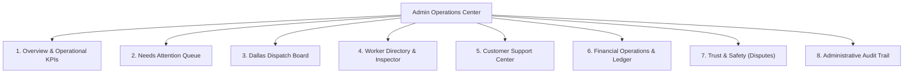
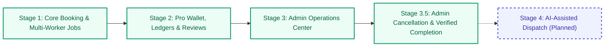

# Crewly — On-Demand & Scheduled Home Services Marketplace (Dallas Pilot)

> **Course:** INSY 3331: Artificial Intelligence for Business  
> **Institution:** The University of Texas at Arlington  
> **Launch Market:** Dallas, Texas (8 Pilot Neighborhoods)  
> **Platform Model:** Two-sided on-demand and scheduled home-services marketplace connecting Dallas residents with qualified local service professionals.  
> **Current Development Status:** Stages 1, 1.1, 1.2, 2, 3, and 3.5 Fully Implemented & Verified.

---

## Table of Contents
1. [Project Overview & Demonstration Context](#1-project-overview--demonstration-context)
2. [The Problem & Our Solution](#2-the-problem--our-solution)
3. [Dallas Pilot Market & Neighborhood Focus](#3-dallas-pilot-market--neighborhood-focus)
4. [Platform Pricing Model & Financial Separation](#4-platform-pricing-model--financial-separation)
5. [Customer Dashboard](#5-customer-dashboard)
6. [Crewly Pro Dashboard](#6-crewly-pro-dashboard)
7. [Admin Operations Center (8 Operational Panels)](#7-admin-operations-center-8-operational-panels)
8. [Stage 3.5 — Admin Booking Lifecycle Controls](#8-stage-35--admin-booking-lifecycle-controls)
9. [Rules-Based Marketplace Operations](#9-rules-based-marketplace-operations)
10. [Technology Stack & Architecture](#10-technology-stack--architecture)
11. [Running Crewly Locally](#11-running-crewly-locally)
12. [Automated Testing & Verification Suite](#12-automated-testing--verification-suite)
13. [Development Roadmap](#13-development-roadmap)
14. [Academic Demonstration Disclaimers & Limitations](#14-academic-demonstration-disclaimers--limitations)

---

## 1. Project Overview & Demonstration Context

**Crewly** is a prototype home-services marketplace engineered as part of **INSY 3331: Artificial Intelligence for Business**. Designed around the high-density residential and single-family rental corridors of Dallas, Texas, Crewly models how modern marketplace platforms coordinate service logistics, multi-worker labor decomposition, transparent pricing, worker earnings ledgers, and human-in-the-loop dispatch operations.

### Academic Demonstration Scope
Crewly is an interactive simulation created for coursework evaluation. The application runs entirely client-side using standard web technologies, simulated worker and customer accounts, and browser storage. It demonstrates the complete end-to-end operational lifecycle of a service marketplace without requiring live payment gateways, background check vendors, or commercial server infrastructure.

---

## 2. The Problem & Our Solution

### The Problem in Local Home Services
Hiring help for common home tasks in the Dallas–Fort Worth metroplex presents persistent frictions for both consumers and independent service professionals:
- **Opaque & Inconsistent Pricing:** Customers face awkward bidding wars, hidden travel surcharges, and post-service price inflation.
- **Coordination Headaches for Multi-Worker Tasks:** Apartment moves, heavy furniture handling, and large shelving projects often require two or more workers. Customers are forced to contact multiple individual handymen and coordinate arrival schedules independently.
- **Partial Fulfillment Risks:** When only one worker agrees to assist with a two-person sofa or refrigerator move, the customer faces a half-staffed job that cannot safely proceed.
- **Unreliable Worker Utilization:** Independent gig workers experience irregular job flow, last-minute cancellations without protection, and schedule conflicts.

### The Crewly Solution
Crewly introduces a coordinated, rules-driven platform model:
- **Upfront Standardized Pricing:** Standard platform rates eliminate bidding and haggling. Customers know the exact subtotal, disclosed \$10 platform fee, and total cost before booking.
- **Multi-Worker Job Decomposition:** A customer booking a two-mover job generates discrete, coordinated assignment slots (`Lead Mover` and `Assistant Mover`). Each position has its own defined payout and skill requirements.
- **Partial Fulfillment Protection:** Bookings requiring multiple workers remain in a clear `Partially Filled (X of N Assigned)` status. Workers are prevented from starting travel or work until the entire required crew is assembled.
- **Deterministic Qualification & Conflict Engine:** Validates verified trade qualifications, required specialized equipment (e.g., commercial lawn mowers, stud finders), weekly availability, and active appointment schedules before allowing any worker to claim a job.
- **Role Isolation & Session State:** Dedicated multi-tab architecture enables simultaneous demonstration of Customer, Pro, and Admin roles without data collisions.

---

## 3. Dallas Pilot Market & Neighborhood Focus

Crewly’s initial operational pilot is mapped to eight representative residential and commercial neighborhoods across Dallas, Texas:

| Neighborhood | Key Postal Codes | Representative Service Demand |
| :--- | :--- | :--- |
| **Uptown Dallas** | 75204 | High-rise apartment moving, elevator logistics, TV & art mounting |
| **Downtown Dallas** | 75201, 75202 | Loft moving, furniture assembly, delivery intake |
| **Deep Ellum** | 75226 | Urban living installations, shelving, furniture disassembly |
| **Bishop Arts District** | 75208 | Historic home maintenance, lawn care, furniture assembly |
| **Lakewood / East Dallas** | 75214 | Single-family homes, yard care, wall mounting & shelving |
| **Oak Lawn** | 75219 | Condo & apartment assembly, mounting, moving assistance |
| **Lower Greenville** | 75206 | Residential moving assistance, furniture assembly |
| **Preston Hollow** | 75225, 75229, 75230 | Multi-room art mounting, large shelving, lawn maintenance |

*Future expansion phases are planned to cover broader Dallas–Fort Worth submarkets including Plano, Frisco, Arlington, and Fort Worth.*

---

## 4. Platform Pricing Model & Financial Separation

Crewly establishes strict transparency rules: **customers see customer rates; workers see individual worker payouts; gross platform margins are visible only to platform administrators.**

All platform pricing reflects published demonstration assumptions:

| Service Category | Pricing Structure | Customer Rate | Worker Payout | Platform Gross Margin |
| :--- | :--- | :--- | :--- | :--- |
| **Moving & Lifting Assistance** | Hourly (per worker) | \$40.00 / worker-hr | \$25.00 / worker-hr | \$15.00 / worker-hr (37.5%) |
| **TV Mounting** | Fixed flat rate | \$109.00 flat | \$75.00 flat payout | \$34.00 (31.2%) |
| **Wall Mounting & Shelving** | Fixed flat rate | \$95.00 flat | \$65.00 flat payout | \$30.00 (31.6%) |
| **Furniture Assembly** | Fixed flat rate | \$90.00 flat | \$55.00 flat payout | \$35.00 (38.9%) |
| **Furniture Disassembly** | Fixed flat rate | \$80.00 flat | \$50.00 flat payout | \$30.00 (37.5%) |
| **Lawn Mowing & Basic Care** | Fixed flat rate | \$55.00 flat | \$35.00 flat payout | \$20.00 (36.4%) |
| **Platform Booking Fee** | Per Booking | \$10.00 flat | — | \$10.00 (100.0%) |

### Financial Disclosures
- **Integer-Cent Accounting:** All calculations are performed in integer cents (`dollarsToCents`, `centsToDollars`) to eliminate floating-point rounding errors.
- **Gross Margin vs. Net Profit:** Platform gross margin represents total customer revenue minus worker payouts and platform fees. Crewly explicitly disclaims that gross margin is **not** net commercial profit, as it does not deduct customer acquisition, insurance reserves, gateway processing fees (2.9% + \$0.30), or operating overhead.

---

## 5. Customer Dashboard

The Customer Dashboard provides an intuitive self-service portal for Dallas residents:


- **Service Selection & Dynamic Intake:** Six standardized home services with dynamic branching intake forms (e.g., TV bracket ownership, wall surface drywall vs. brick, moving truck requirements, stair flights).
- **Transparent Pricing Breakdown:** Real-time quote displaying service labor subtotal, disclosed \$10 platform booking fee, and guaranteed total.
- **Scheduling Options:**
  - **Scheduled Appointments:** Select preferred date and time slot.
  - **ASAP On-Demand Matching:** 60-minute dispatch window with live countdown timer. If unfulfilled near expiration, customers can extend the search window by 30 minutes with a single click.
- **Multi-Worker Job Support:** Customers specify crew size (e.g., 2 movers for 3 hours). The booking clearly indicates how many positions are currently filled.
- **Live Lifecycle Tracking Stepper:** Real-time visual progress through seven distinct operational milestones:
  `Requested` $\rightarrow$ `Seeking Pros` $\rightarrow$ `Partially Filled` $\rightarrow$ `Fully Confirmed` $\rightarrow$ `En Route` $\rightarrow$ `Arrived` $\rightarrow$ `In Progress` $\rightarrow$ `Completed`.
- **Individual Worker Reviews:** Following job completion, customers review each assigned worker independently with 1–5 star ratings, feedback tags, and written comments. Ratings update worker averages via weighted historical averages without bleeding across co-workers.

---

## 6. Crewly Pro Dashboard

The Crewly Pro Dashboard empowers local trade professionals to manage their gig operations:

- **Filterable Job Board:** Real-time feed of available opportunities in the Pro's service area. Filterable by `Available`, `My Claimed Jobs`, and `Ineligible Positions`.
- **Explicit Ineligibility Badging:** When a Pro cannot claim a job, the platform displays clear, transparent disqualification badges (e.g., `Missing Verified Lawn Equipment`, `Unverified Skill Qualification`, `Schedule Conflict with CRW-1001`, `Day Unavailable`).
- **One-Click Acceptance:** Qualified Pros can claim open assignment slots immediately.
- **Lifecycle Job Stepper:** Assigned Pros manage job execution through sequential action buttons:
  `Mark En Route (🚗)` $\rightarrow$ `Mark Arrived (📍)` $\rightarrow$ `Start Job (⚡)` $\rightarrow$ `Complete Job (✓)`.
- **Pro Reward Tiers:** Transparent gamification recognizing worker track records:
  - **Bronze:** Entry tier (reliability $\ge 80\%$).
  - **Silver:** Established Pro (reliability $\ge 85\%$, rating $\ge 4.5$).
  - **Gold:** High-demand Pro (reliability $\ge 90\%$, rating $\ge 4.8$, 25+ completed jobs).
  - **Platinum:** Elite Pro (reliability $\ge 95\%$, rating $\ge 4.9$, 50+ completed jobs).
- **Earnings & Simulated Wallet Ledger:**
  - **Pending Balance:** Track committed earnings for upcoming and in-progress jobs.
  - **Available Balance:** Earnings released immediately upon job completion.
  - **Lifetime Earned:** Permanent historical milestone tracker.
  - **Append-Only Transaction History:** Itemized ledger logging earnings credits and cash-outs.
- **Simulated Cash-Out System:**
  - **Standard Cash-Out:** Free withdrawal (\$0.00 fee) simulating 2–3 business day ACH transfer.
  - **Instant Cash-Out:** Express simulated transfer with a \$1.50 platform convenience fee.
  - Generates verifiable, printable simulated withdrawal receipts with stable transaction reference IDs.

---

## 7. Admin Operations Center (8 Operational Panels)

The Crewly Admin Operations Center gives human dispatchers and marketplace operators total visibility and control over platform operations:



### 1. Overview Panel
- Executive dashboard tracking total booking volume, open requests, partially filled jobs, confirmed active jobs, and completed services.
- Real-time Gross Booking Value (GBV) breakdown distinguishing **Projected GBV** (open/active bookings) from **Realized Completed GBV**.
- Platform fee aggregates and gross margin calculations with explicit commercial disclaimers.

### 2. Needs Attention Queue
- Proactive rules engine monitoring dispatch bottlenecks:
  - **Staffing Shortages:** Multi-worker bookings missing required workers within 48 hours of service.
  - **Expiring ASAP Windows:** On-demand requests within 15 minutes of deadline.
  - **Critical Support Cases:** Open tickets requiring manual coordinator intervention.

### 3. Dallas Dispatch Board
- Live operational view of every active and historical booking in the marketplace.
- Displays crew staffing ratios (e.g., `1 of 2 positions filled`), customer details, timing, and address.
- Interactive candidate inspector: evaluates all registered Pros, displaying eligibility status and disqualification reasons.
- **Manual Assignment & Unassignment:** Administrators can manually assign eligible Pros or unassign workers prior to job commencement, with automatic integer-cent pending balance reversals.

### 4. Worker Directory & Eligibility Inspector
- Complete roster of registered Dallas Pros displaying tier, rating, review count, reliability score, and completed job counts.
- Verified service qualifications and equipment credentials (e.g., commercial mower, heavy truck, stud finder).
- Weekly day-by-day availability schedules.
- Interactive Booking Eligibility Inspector: select any active booking to test every Pro's qualification profile in real time.

### 5. Customer Support Center
- Unified case management engine (`state.supportCases`) handling customer inquiries, worker complaints, and dispatch escalations.
- Stable unique identifiers (`CASE-101`), severity prioritization (`Low`, `Medium`, `High`, `Critical`), and status tracking (`Open`, `Under Review`, `Resolved`).
- Append-only internal dispatcher notes quarantined from customer view to maintain operational privacy.

### 6. Financial Operations & Platform Ledger
- Centralized visibility into all worker wallet balances (Available, Pending, Lifetime).
- Master platform ledger recording simulated earnings credits, cash-out withdrawals, and instant cash-out convenience fees.
- Financial recalculation routines verified to ensure zero unintended balance mutations during inspection.

### 7. Trust & Safety Center
- Moderation console displaying all customer reviews and ratings across Dallas bookings.
- Review dispute workflow: dispatchers can flag reviews for formal investigation, creating an linked Trust & Safety case (`CASE-TS-201`).
- **Reputation Protection Rule:** Disputing a review marks it as `Under Investigation` but strictly preserves the original star rating, worker average rating, and review count during inquiry.

### 8. Administrative Audit Trail
- Immutable, append-only operational log recording every administrative action:
  `worker_assigned`, `worker_unassigned`, `booking_canceled`, `admin_completion_verified`, `support_case_created`, `support_case_status_updated`, `review_dispute_flagged`, and `admin_lifecycle_action_rejected`.
- Logs timestamp, operator name, booking/case references, status transitions, and documented administrative reasons.

---

## 8. Stage 3.5 — Admin Booking Lifecycle Controls

Stage 3.5 introduced two vital human-controlled operational workflows into the Admin Dispatch Center:

### Admin Booking Cancellation
- **Eligible Pre-Work Scope:** Administrators can cancel bookings in pre-work states (`waiting_for_pros`, `partially_filled`, `fully_confirmed`).
- **All-or-Nothing Pending Reversals:** Atomic validation ensures all assigned Pros' attributable pending earnings are reversed in integer cents. Completed earnings, available balances, and historical cash-outs are never modified.
- **Historical Snapshot:** Cancelled bookings retain a permanent `cancellationSnapshot` preserving former assigned workers, reversed payouts, previous status, cancellation timestamp, administrator name, and documented reason.
- **Pro Job Board Exclusion:** Cancelled bookings transition to `overallStatus: 'cancelled'` and are permanently removed from the Pro Job Board.
- **Active Work Safeguards:** If any assigned worker has started traveling (`traveling`), arrived (`arrived`), or begun work (`in_progress`), dispatch cancellation is strictly blocked. The UI renders an orange **"⚠️ Escalate to Support"** button that auto-populates a high-priority ticket for manual investigation.
- **Customer Privacy:** Customer notifications display sanitized administrative notices while strictly concealing internal dispatcher notes and worker payout figures. Refund status is transparently marked *"Pending Manual Review — No Refund Processed"*.

### Admin-Verified Job Completion
- **Single Source of Truth:** Does not duplicate earnings logic. Reuses the shared Pro completion engine (`updateProAssignmentStatus`) to guarantee consistency across assignment statuses, pending-to-available balance transfers, lifetime earnings, and ledger transactions.
- **Affirmative Verification Standards:** Requires documented verification from a classroom simulation source:
  - `Customer Direct Phone Confirmation (Demo Simulation)`
  - `On-Site Dispatcher Field Check (Demo Simulation)`
  - `Customer Support Ticket Verification (Demo Simulation)`
- **Mandatory Documentation:** Dispatchers must provide internal verification notes and confirm an affirmative completion checkbox before payout release.
- **Multi-Worker Protection:** In multi-worker jobs, completing one worker releases only that worker's earnings. The overall booking remains `⚡ In Progress` until every assigned position has completed.
- **Idempotent Execution:** Completed assignments cannot be completed a second time, preventing duplicate earnings credits.

---

## 9. Rules-Based Marketplace Operations

All matching, eligibility, and operational features in Crewly operate on **deterministic, transparent business logic**. 

> [!IMPORTANT]
> Crewly currently uses rules-based algorithms and decision trees. It does not use generative AI, neural networks, or autonomous LLM agents for dispatch decisions.

### Core Deterministic Algorithms
1. **Candidate Eligibility Evaluation:** Set intersection between required service category and the worker's verified qualification list (`pro.verifiedServices.includes(booking.serviceCategory)`).
2. **Equipment Verification:** For equipment-dependent services (e.g., lawn care requiring commercial mower and trimmer), the engine inspects verified gear inventories.
3. **Weekly Availability Matcher:** Validates that the appointment day matches the Pro’s active weekly schedule (`pro.weeklyAvailability[dayName].enabled`).
4. **Time-Interval Conflict Detection:** Calculates the scheduled job duration window $[t_{\text{start}}, t_{\text{end}}]$ and checks against all active assignments for that Pro, flagging overlapping windows.
5. **Rules-Based Alert Generation:** Deterministic threshold checks evaluating hours-until-appointment against filled slot ratios and elapsed ASAP window minutes.

---

## 10. Technology Stack & Architecture

Crewly is built from the ground up to be lightweight, modular, and dependency-free:

- **Frontend:** Semantic HTML5, modern CSS3 (Custom Properties, Flexbox, CSS Grid).
- **Responsive Design:** Verified across three device viewports: Mobile (390px), Tablet (768px), and Desktop (1440px).
- **Logic & State Engine:** Vanilla JavaScript using native ES6 modules (`import` / `export`).
- **Zero Build Step:** Runs directly in any modern browser without Webpack, Vite, Babel, npm dependencies, or node_modules.
- **Client-Side Persistence:** `localStorage` for cross-session marketplace state; `sessionStorage` and URL query parameters (`?role=customer`, `?role=pro`, `?role=admin`) for tab-specific role isolation.
- **Cross-Tab Synchronization:** Custom event dispatching and `window.addEventListener('storage', ...)` coordinate state across open browser tabs.
- **Static Hosting Compatibility:** Fully compatible with static web hosts, including GitHub Pages.

---

## 11. Running Crewly Locally

Because Crewly utilizes native ES6 JavaScript modules, it must be served over HTTP/HTTPS rather than opened directly via `file://`.

### Quick Start (Python 3)
```bash
# 1. Clone the repository
git clone https://github.com/benjamin-insy/Ai-for-Business-Project.git
cd Ai-for-Business-Project

# 2. Switch to the active development branch
git checkout feature/crewly-product-improvements

# 3. Start a local static HTTP server
python3 -m http.server 8000
```

Open your browser to:
```text
http://localhost:8000
```

### Multi-Tab Role Demonstration
You can run all three marketplace perspectives simultaneously in separate browser tabs:
- **Customer View:** `http://localhost:8000/?role=customer`
- **Crewly Pro View:** `http://localhost:8000/?role=pro`
- **Admin Operations Center:** `http://localhost:8000/?role=admin`

To restore initial demonstration data at any time, click the **"🔄 Reset Demo Data"** button in the header.

---

## 12. Automated Testing & Verification Suite

Crewly features a comprehensive automated regression suite to ensure financial, dispatch, and state integrity across releases.

### Test Runner Execution
Execute the master test runner from the repository root:
```bash
./tests/run_all_tests.sh
```

### Test Suite Structure
The test runner validates **430 automated assertions across six core test suites** with a 100% pass rate:

| Suite # | Description | Test Harness / Runtime | Assertions | Status |
| :---: | :--- | :--- | :---: | :---: |
| **Suite 1** | ES Module Startup & Clean Browser DOM Parsing | JavaScriptCore (`jsc -m`) | **23** | **PASS** |
| **Suite 2** | Stage 3 Phase 1: Overview KPIs, Margin & Alerts | Python 3 (`test_phase1_overview.py`) | **41** | **PASS** |
| **Suite 3** | Stage 3 Phase 2: Dispatch Board & Audits | Python 3 (`test_phase2_dispatch.py`) | **72** | **PASS** |
| **Suite 4** | Stage 3 Phase 3: Directory, Support, Finance, Trust | Python 3 (`test_phase3_operations.py`) | **81** | **PASS** |
| **Suite 5** | Stage 3 Phase 4: End-to-End Marketplace Scenarios A–H | JavaScriptCore (`jsc -m`) | **140** | **PASS** |
| **Suite 6** | Stage 3.5: Admin Cancellation & Verified Completion | JavaScriptCore (`jsc -m`) | **73** | **PASS** |
| **TOTAL** | **Master Platform Verification Suite** | **`./tests/run_all_tests.sh`** | **430 / 430** | **100%** |

*(An extended regression harness `tests/test_chrome_issues_verification.js` covers 34 additional UI-specific browser interaction assertions for a grand total of 464 passing assertions.)*

### Testing Methodology Disclosure
- **Headless Simulated Engine:** The automated test runner executes through macOS Darwin's native JavaScriptCore WebKit engine (`jsc`) and Python 3. This environment provides headless verification of state machines, integer-cent arithmetic, and module parsing.
- **Manual Chrome Testing:** In addition to automated headless testing, core interactive scenarios (booking creation, multi-tab dispatch, role switching, cancellation modals, and verified payouts) have been manually tested and verified in Google Chrome.

---

## 13. Development Roadmap



- [x] **Stage 1 (Core Marketplace):** Upfront pricing, 6 service categories, multi-worker job decomposition, partial fulfillment protection, Dallas pilot geography.
- [x] **Stage 1.1 & 1.2 (ASAP Dispatch & Polish):** 60-minute ASAP matching countdown, window extensions, schedule conflict prevention.
- [x] **Stage 2 (Worker Experience & Financials):** Pro job board, verified credential checking, sequential job lifecycle, reward tiers, pending vs. available wallet balances, simulated instant cash-outs, individual worker ratings and reviews.
- [x] **Stage 3 (Admin Operations Center):** Overview KPIs, Rules-Based Needs Attention alerts, Dispatch Center with manual candidate inspection, Worker Directory, Support Case Management, Financial Platform Ledger, Trust & Safety dispute resolution, Administrative Audit Trail.
- [x] **Stage 3.5 (Admin Booking Lifecycle Controls):** All-or-nothing pre-work cancellation, active work protections, Customer Support escalation routing, affirmative completion verification reusing shared completion engine, audit logging.
- [ ] **Stage 4 (AI-Assisted Dispatch — Planned Next):** Integrating generative AI and LLM assistance into the Admin Dispatch Center to analyze staffing shortages, generate candidate recommendations, draft dispatcher reasoning, and suggest resolution strategies—always subject to **human administrator approval**.

---

## 14. Academic Demonstration Disclaimers & Limitations

In accordance with academic integrity guidelines for INSY 3331 at The University of Texas at Arlington:

1. **Fictional Profiles & Data:** All customer names (e.g., Sarah Jenkins, David Miller) and Pro profiles (e.g., Marcus Davis, Elena Rodriguez, Carlos Mendez, Jamar Washington) are fictional demonstration personas. Phone numbers, addresses, and ratings are simulated.
2. **No Real Financial Transactions:** All monetary figures, wallet balances, platform fees, gross revenues, and instant cash-outs are client-side simulations. Crewly does not connect to Stripe, PayPal, banking networks, or credit card processors.
3. **No Production Authentication:** The role selector (`Customer`, `Pro`, `Admin`) is a demonstration convenience tool. It does not provide cryptographic authentication, OAuth, password hashing, or role-based security access control.
4. **Simulated Telematics:** Worker transit times, arrival statuses, and neighborhood locations are simulated state milestones. There is no background GPS tracking or real-time geolocation.
5. **No Commercial Live Services:** Crewly is a prototype application built for classroom instruction, project evaluation, and demonstration of marketplace systems architecture. It is not offered as a commercial service.

---

*Crewly — INSY 3331: Artificial Intelligence for Business — University of Texas at Arlington*
